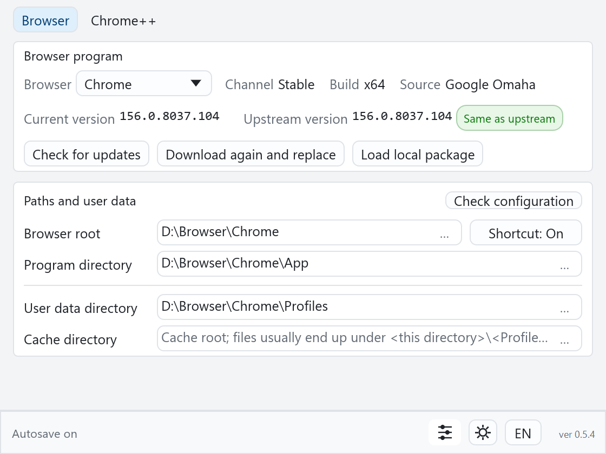
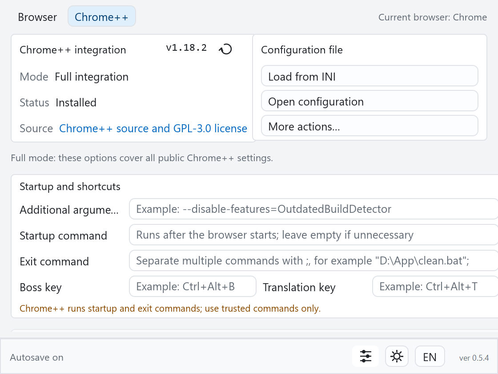

  

<h1 align="center">Browser Harbor 🚢</h1>

  <b>Portable browsers without the ritual sacrifice.</b> 
  A small native Windows tool for downloading, verifying, installing, updating,
  and configuring 14 Chromium- and Firefox-family browsers.

  
  
  
  
  

  <a href="README.zh-CN.md">简体中文</a> ·
  <a href="docs/USER_GUIDE.md">User guide</a> ·
  <a href="CHANGELOG.md">Changelog</a>

  
  

Browser setup · Chrome++ configuration

---

## 😵‍💫 Why does this exist?

Portable browser setup is mostly manual file management with extra steps.

The installer expects system-wide access. The versioned folder changes with the
next update. The profile ends up somewhere you did not choose. Then there are
`version.dll` and the INI files to sort out. Calling that "portable" is generous.

**Browser Harbor handles that work:** download, verify, extract, arrange, and
preserve. The next update does not require rediscovering the layout.

Windows also remembers monitors that were unplugged in 2022. Fixing that is an
exorcism for another day; Browser Harbor settles for keeping its own window on
the current desktop.

## ⚡ What it does

- **Downloads from declared sources.** Official vendor endpoints, release APIs,
  signed metadata, and approved mirrors. No mystery `.exe` from page four of a
  forum thread.
- **Trusts bytes only after checking them.** Browsers, Chrome++, Libportable,
  and local packages require trusted integrity data; LibreWolf additionally
  gets an OpenPGP signature check.
- **Keeps the layout sane.** Program, data, profile, optional cache, and
  auto-created shortcuts have predictable places.
- **Handles Chromium’s awkward corners.** Check and update Chrome++ independently,
  reuse one verified download across targets, keep other running browsers out of
  the way, and patch Edge’s dynamic version directories and `version.dll` import.
- **Makes every Firefox-family target directly portable.** Firefox, Floorp,
  LibreWolf, and Zen use Libportable; Iceweasel and SkyKakapo keep their native
  runtimes. Redundant Floorp/LibreWolf launchers are removed.
- **Relocates without guessing.** Choose the new Browser Root and Browser Harbor
  remaps the paths. A known different browser is rejected even when its
  executable is also named `chrome.exe`; an unknown custom build gets an explicit
  warning first.
- **Checks before it repairs.** Diagnostics are read-only. Path fixes require
  confirmation, a closed browser, and an INI backup.
- **Keeps the window on a screen that exists.** Saved coordinates are clamped to
  the current virtual desktop.
- **Saves immediately.** Every valid edit is persisted. Keep manager state in
  the per-user configuration directory or move `BrowserHarbor.json` beside the EXE
  for a portable setup. Existing `manager.json` files are migrated automatically.
- **Looks at home on Windows.** Follow the system theme or choose light/dark;
  switch between Chinese and English when required.
- **Deletes only rebuildable downloads.** Cache cleanup leaves programs, profiles,
  bookmarks, and logins alone.

## 🌐 Supported browsers

| Family | Browsers |
|---|---|
| **Chromium** | Brave, Catsxp, Chrome, Edge, Helium, Thorium, Turbo, Ungoogled Chromium |
| **Firefox** | Firefox, Floorp, Iceweasel, LibreWolf, SkyKakapo, Zen |

Iceweasel supports both ESR and Release channels. Thorium provides CPU-specific
builds for SSE3, SSE4, AVX, AVX2, and AVX512.

## 🚀 Quick start

1. Download `BrowserHarbor-0.5.4-x64.exe` from
   [GitHub Releases](https://github.com/MagicCube99/browser-harbor/releases/latest).
   If GitHub is unreachable, use the [Gitee mirror](https://gitee.com/MagicCube99/browser-harbor/releases).
2. Put it in any writable folder and run it.
3. Select a browser and confirm its Browser Root and data paths.
4. Use **Check configuration** for an existing setup, or
   **Download and install/upgrade** for a clean install.

No installer. No administrator rights. No background service. No WebView2.

The EXE is enough for normal use. The separately attached manifest, signature,
and public key are optional for independent verification. Compare the EXE with
the SHA-256 in the release notes if you prefer to know exactly what you are
running.

## 🧨 Known rough edges

- **Experimental labels:** Brave, Helium, and Ungoogled Chromium are usable, but
  their deeper Chrome++ compatibility remains experimental.
- **SmartScreen warnings:** The binary is not Authenticode-signed yet. A warning
  is expected.
- **Manual orientation required:** Existing folders do not import themselves.
  Select the target, then use **Check configuration** or **Relocate…**.
- **Windows x64 only:** Windows 10 22H2 or Windows 11. Older systems are not
  supported.

## 🙅 What it deliberately does not do

- It does not launch or supervise browsers.
- It does not register a default browser or create taskbar pins.
- It does not read browser history.
- It does not execute downloaded installers as setup programs.
- It does not treat a download mirror as proof of authenticity.

You get a browser downloader and manager—not another tray resident that develops
opinions.

## 🤖 AI disclosure & license

AI drafted a large share of the code, tests, parsers, and release plumbing. A
human supplied the constraints, tested real browsers, rejected ideas that
compiled but should not have existed, and remains responsible for the result.

The compiler held veto power. Clippy offered persistent feedback. Neither was
allowed near the default-browser registry, which conveniently does not exist
here.

The project is available under either the [MIT License](LICENSE-MIT) or the
[Apache License 2.0](LICENSE-APACHE), at your option (`MIT OR Apache-2.0`).
Third-party browsers and runtime components retain their own licenses, notices,
and signing requirements.

---

More reading:

- [User guide](docs/USER_GUIDE.md) / [中文用户指南](docs/USER_GUIDE.zh-CN.md)
- [Changelog](CHANGELOG.md) / [中文更新记录](CHANGELOG.zh-CN.md)
- [Security](SECURITY.md) / [Privacy](PRIVACY.md)
- [Third-party notices](THIRD_PARTY_NOTICES.md)
- [Contributing](CONTRIBUTING.md)
