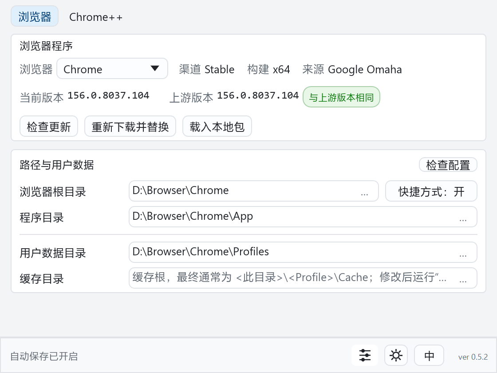
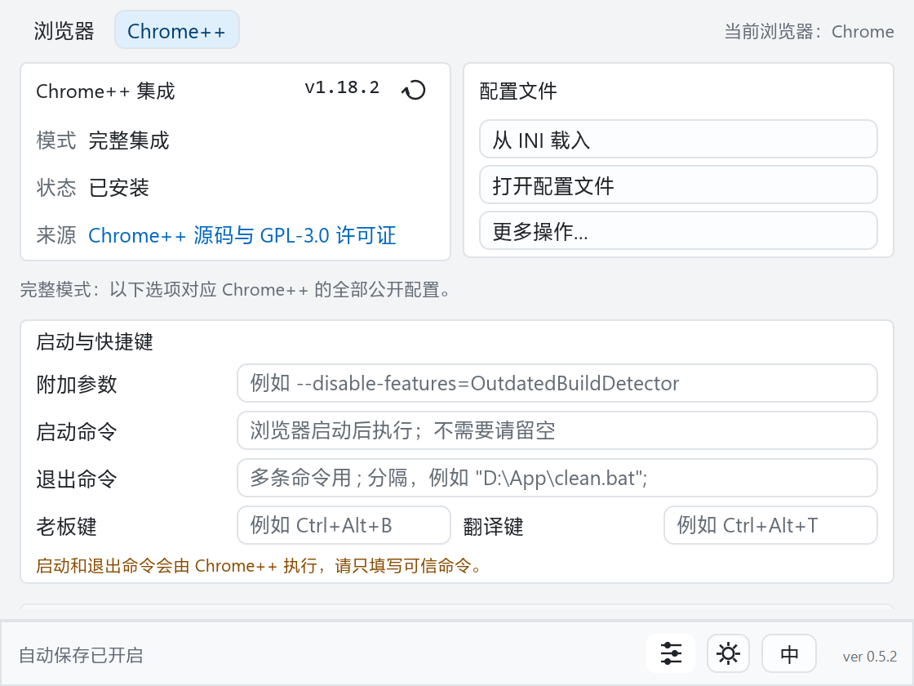

  

<h1 align="center">Browser Harbor（浏览器港湾）</h1>

  <b>便携浏览器，少折腾一点。</b> 
  一个小型原生 Windows 工具，用于下载、校验、安装、更新和配置
  14 个 Chromium 系与 Firefox 系浏览器。

  
  
  
  
  

  <a href="README.md">English</a> ·
  <a href="docs/USER_GUIDE.zh-CN.md">用户指南</a> ·
  <a href="CHANGELOG.zh-CN.md">更新记录</a>

  
  

浏览器配置 · Chrome++ 配置

---

## 为什么需要它

把浏览器做成真正能带走的便携版，实际做起来往往很麻烦。

浏览器安装包通常默认装入系统目录，升级时还可能更换版本文件夹；用户数据、缓存和便携配置也经常散在不同位置，最后只能手工整理。很多所谓“便携版”，只是把文件都放在一个目录里；能拷走，不代表能正常用。

**Browser Harbor 把这些步骤收拢到一个窗口里：** 下载、校验、解压、整理目录、保留数据。下次升级时也不用重新配置一遍。

## 功能

- **来源明确。** 下载地址来自厂商官方接口、Release API、签名元数据或允许的加速站；论坛附件不算来源。
- **校验后才放行。** 浏览器、Chrome++、Libportable 和本地安装包都要匹配可信的校验信息；LibreWolf 还会检查 OpenPGP 签名。
- **目录互不打扰。** 程序、数据、Profile、可选缓存和自动创建的快捷方式都有固定位置。
- **处理 Chromium 系常见的兼容问题。** Chrome++ 可独立检查和更新；同一版本只下载一次，并可在多个目标间复用；其他浏览器继续运行不会误阻止当前目标，同时支持 Edge 动态版本目录和 `version.dll` 导入修复。
- **Firefox 系全部直接便携。** Firefox、Floorp、LibreWolf 和 Zen 使用 Libportable，Iceweasel 与 SkyKakapo 保留各自原生运行时；多余的 Floorp/LibreWolf 启动器会被删除。
- **重定位先核对。** 选择新的 Browser Root 后再映射路径；已知属于其他浏览器的 `chrome.exe` 会被拒绝，未知自定义构建会先给出警告。
- **检查只读，修复留痕。** 配置检查不会修改文件；修复路径前需要确认、关闭浏览器并备份 INI。
- **窗口不会留在屏幕外。** 保存的坐标会限制在当前虚拟桌面内。
- **编辑立即保存。** 管理器配置默认保存在用户目录，也可把 `manager.json`
  放到 EXE 旁，随程序一起带走。
- **只清理可重建内容。** 清理下载缓存不会动已安装程序、Profile、书签或登录状态。
- **外观和语言可调。** 支持跟随系统、浅色、深色，以及中英文界面。

## 支持的浏览器

| 系列 | 浏览器 |
|---|---|
| **Chromium** | Brave、Catsxp、Chrome、Edge、Helium、Thorium、Turbo、Ungoogled Chromium |
| **Firefox** | Firefox、Floorp、Iceweasel、LibreWolf、SkyKakapo、Zen |

Iceweasel 提供 ESR 与 Release 两种渠道。Thorium 提供面向
SSE3、SSE4、AVX、AVX2 和 AVX512 的 CPU 构建。

## 开始使用

1. 从 [GitHub Releases](https://github.com/MagicCube99/browser-harbor/releases/latest)
   下载 `BrowserHarbor-0.5.2-x64.exe`。
   无法访问 GitHub 时，可从 [Gitee 镜像](https://gitee.com/MagicCube99/browser-harbor/releases)下载。
2. 放进任意可写目录，直接运行。
3. 选择浏览器，确认 Browser Root 和数据路径。
4. 已有安装先用 **检查配置**；全新安装选择 **下载并安装/升级**。

不需要安装器、管理员权限、后台服务或 WebView2。

普通使用只需 EXE。Release 中另附的清单、签名和公钥用于独立验证，可选下载。
需要核对时，可以与发布说明中的 SHA-256 比较。

## 当前限制

- **三个实验性目标：** Brave、Helium 和 Ungoogled Chromium 可以使用，但完整 Chrome++ 兼容性仍标记为实验性。
- **可能被 SmartScreen 拦截：** EXE 尚未做 Authenticode 签名，出现提示属于预期情况。
- **已有目录不会自动导入：** 选择目标后，使用 **检查配置** 或 **重新定位…**。
- **仅支持 Windows x64：** 系统要求为 Windows 10 22H2 或 Windows 11。

## 不在功能范围内

- 不启动，也不监管浏览器进程。
- 不注册默认浏览器，不固定任务栏。
- 不读取浏览历史。
- 不把下载的安装器当作安装向导执行。
- 不把传输加速站当作信任根。

它只负责下载和管理浏览器，不会常驻托盘，也不会顺手改掉系统里的其他设置。

## AI 参与与许可证

代码、测试、解析器和发布流程中有相当一部分由 AI 起草。人负责提出约束、用真实浏览器测试、否掉那些“虽然能编译但不该存在”的主意，并对最终结果负责。

代码能不能通过由编译器把关，Clippy 则负责挑出不够干净的地方。默认浏览器注册表不在讨论范围内——这个项目没有相关代码。

项目采用 [MIT](LICENSE-MIT) 或 [Apache-2.0](LICENSE-APACHE) 双许可证，SPDX 标识为 `MIT OR Apache-2.0`，下游可以任选其一。第三方浏览器和运行时组件仍适用各自的许可证、声明和签名要求。

---

继续阅读：

- [用户指南](docs/USER_GUIDE.zh-CN.md) / [English](docs/USER_GUIDE.md)
- [更新记录](CHANGELOG.zh-CN.md) / [Changelog](CHANGELOG.md)
- [安全说明](SECURITY.zh-CN.md) / [隐私说明](PRIVACY.zh-CN.md)
- [第三方声明](THIRD_PARTY_NOTICES.md)
- [参与贡献](CONTRIBUTING.zh-CN.md)
